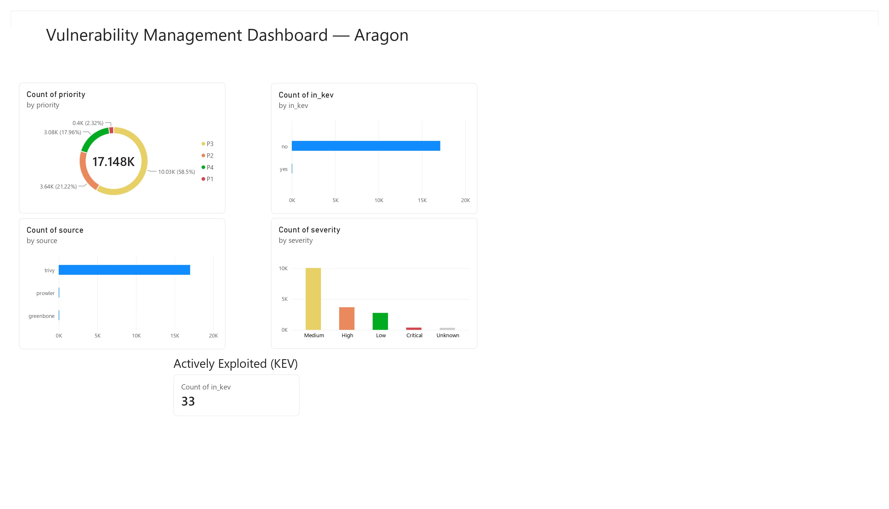

# Vulnerability Management Pipeline

An end-to-end vulnerability management pipeline that collects findings from three
different sources (cloud, network, and containers), normalizes them into a single
format, enriches them with real-world exploitability data, and prioritizes them by
risk — turning 17,000+ raw findings into a short, actionable list.

Built as a hands-on portfolio project to demonstrate the full vulnerability
management workflow used by SOC and Vulnerability Management analysts.



## The problem

Any real environment produces thousands of vulnerability findings. Nobody can fix
thousands of issues at once. The job of vulnerability management is not finding
vulnerabilities (a scanner does that automatically) — it's deciding **what to fix
first** with limited resources, based on **real-world exploitability**, not just
severity.

This pipeline answers one question: *out of 17,000+ findings, which ones actually
matter right now?*

## Pipeline flow

```
Scan  ->  Normalize  ->  Enrich  ->  Prioritize  ->  Dashboard
```

1. **Scan** — collect findings from three sources.
2. **Normalize** — unify three different formats into one common schema.
3. **Enrich** — add CISA KEV (actively exploited) and EPSS (probability of exploitation).
4. **Prioritize** — assign P1–P4 priority with remediation SLAs.
5. **Dashboard** — visualize the results in Power BI.

## Data sources

| Source | Scope | Tool |
|--------|-------|------|
| Cloud (AWS) | Account misconfigurations (public buckets, no MFA, open security groups) | Prowler |
| Network | Hosts: open ports, services, and CVEs | Greenbone / OpenVAS |
| Containers | Image contents: packages and dependencies with CVEs | Trivy |

## Tech stack

- **Python** — normalization, enrichment, and scoring scripts
- **Prowler, Greenbone/OpenVAS, Trivy** — scanning
- **CISA KEV, FIRST EPSS** — exploitability enrichment
- **Power BI** — dashboard
- **AWS, Kali Linux, Docker, VirtualBox** — lab environment

## Key results

- **17,148** total findings collected across all three sources
- **398** classified as P1 (highest priority)
- **33** found in the CISA KEV catalog — actively exploited in the real world

The takeaway: severity alone is not enough. Of 17,148 findings, only 33 are
confirmed as actively exploited. Prioritizing by exploitability — not raw severity
— is the core of vulnerability management.

## Repository structure

```
src/        normalization, enrichment, and scoring scripts
data/        raw scan outputs (gitignored) and processed results
docs/        scan documentation and dashboard image
lab/         asset inventory
dashboard/   Power BI file
```

## How to run

```bash
# 1. Normalize the three scan sources into one common format
python src/normalize.py

# 2. Enrich with KEV and EPSS exploitability data
python src/enrich.py

# 3. Assign risk-based priority (P1-P4) with SLAs
python src/score.py
```

The final output (`data/processed/findings_scored.csv`) feeds the Power BI dashboard.